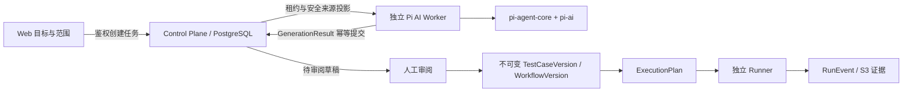

# ADR 0002：采用 Pi 作为独立 AI Worker 的底层 harness

日期：2026-09-12。状态：**已实现并完成真实模型、PostgreSQL、浏览器与 Runner 联合验收。**

## 决策

采用 `@earendil-works/pi-agent-core@0.85.1` 与 `@earendil-works/pi-ai@0.85.1`。
它们只属于 `apps/ai-worker`，通过新版本化 `generation-protocol` 契约交付 GeneratedDraft。
保留 Fastify Control Plane、PostgreSQL、S3 证据存储和独立 Node.js Runner。

使用 Pi 的 Agent 循环和模型适配，不把 coding CLI 的默认工具权限、交互终端或本地配置加载器嵌入服务端。
此决定来自用户明确指定 Pi，以及项目需要嵌入式 TypeScript 工具循环和现有进程边界。

## 网络核实：Pi 是什么，热度意味着什么

旧 `badlogic/pi-mono` 地址已重定向至 [earendil-works/pi](https://github.com/earendil-works/pi)。
官方当前包名为 `@earendil-works/*`，旧教程的 `@mariozechner/*` 不能直接用于当前接入。
官方根 README 将其定义为 agent harness 工具集合；许可证为 MIT。

通过官方 GitHub API 在本轮抓取的快照：

| 项目 | Stars（2026-09-12 抓取，非稳定数值） | 官方定位/本项目适配判断 |
|---|---:|---|
| [Pi](https://github.com/earendil-works/pi) | 104,330 | 可嵌入 Agent loop 与多 provider 接口，匹配现有 TypeScript Worker |
| [OpenCode](https://github.com/anomalyco/opencode) | 206,857 | 完整 coding-agent 产品；直接作为业务测试内核会增加产品层耦合 |
| [LangGraph](https://github.com/langchain-ai/langgraph) | 41,521 | 强调持久执行与可恢复图式编排；值得借鉴恢复模型，此处先由 CP 承担任务可靠性 |
| [OpenAI Agents JS](https://github.com/openai/openai-agents-js) | 3,800 | 提供 agents/handoffs/guardrails/tracing；是可比较 SDK，但用户已选择 Pi |

这些不是同类性能基准，仓库统计口径不同，也不是生产采用率。**现有证据不足以称 Pi“全网最热门”**；
它在该样本中具有高关注度且近期活跃。选型不以 Stars 代替安全性、质量或可维护性验证。
表中适配判断是本项目的工程推论。

官方 API 端点可复核：[Pi](https://api.github.com/repos/earendil-works/pi)、
[OpenCode](https://api.github.com/repos/anomalyco/opencode)、
[LangGraph](https://api.github.com/repos/langchain-ai/langgraph)、
[Agents JS](https://api.github.com/repos/openai/openai-agents-js)。

## 接口与版本证据

- [官方 agent README](https://github.com/earendil-works/pi/blob/main/packages/agent/README.md)：Agent 状态、工具执行、事件、取消、上下文转换及循环控制。
- [官方 pi-ai README](https://github.com/earendil-works/pi/blob/main/packages/ai/README.md)：模型与 provider 抽象。
- [官方 coding-agent SDK 文档](https://github.com/earendil-works/pi/blob/main/packages/coding-agent/docs/sdk.md)：较高层会话/编码应用嵌入能力。
- [npm 当前 agent 包元数据](https://registry.npmjs.org/@earendil-works/pi-agent-core/latest)：本轮返回 0.85.1、Node ≥22.19.0、官方仓库与依赖。
- [0.85.1 版本记录](https://github.com/earendil-works/pi/releases/tag/v0.85.1)。

具体实现同时以已安装 0.85.1 类型声明和测试为准，避免 main 分支文档随更新漂移。
主项目原有 Node ≥22.13.0；新 Worker 单独要求 ≥22.19.0。本轮使用 Node 24.20.0。
直接 Pi 依赖精确锁定，传递依赖由 pnpm-lock.yaml 固定；升级要重新检查类型、工具行为和回归测试。

## 产品与基础设施的职责

| 层 | 负责 | 不授予的职责 |
|---|---|---|
| Web | 目标/范围输入、任务状态、完整草稿编辑与审阅 | 直接持有模型密钥或把模型文本当执行结果 |
| Control Plane | 工作区授权、GenerationJob、租约、来源投影、输出校验、草稿事务、审阅与发布 | 同进程启动或依赖 Pi 生命周期 |
| Pi AI Worker | 有界工具循环、候选测试、引用依据、模型交互 | 发布 TestCaseVersion、解析执行 Secret、访问被测系统 |
| Runner | 冻结 ExecutionPlan、HTTP 执行、脱敏 RunEvent | 运行时重新生成测试或由模型决定断言结果 |
| PostgreSQL / S3 | 元数据与任务可靠性 / 内容寻址来源与证据 | 依赖模型聊天上下文作为唯一存储 |

已实现的链路：

## 本轮可运行验证

`apps/ai-worker` 接受单个 stdin JSON 任务，输出 stdout JSON 结果。每次调用创建新的 Agent，提供两个领域工具：

1. `read_endpoint`：读取任务内端点摘要、状态码、风险等级与契约说明。
2. `propose_test`：读取过来源后，提交现有 TestDefinition 结构和说明。

Worker 校验非空断言、精确的方法和模板 URL、源端点规定的风险级别、至少一个已声明状态码断言、
草稿 ID 唯一性、数量预算。来源由结果 envelope 写入，模型不能伪造已发布状态或覆盖 provenance。
结果包括 job/workspace/API/sourceHash/inputHash、provider/model、harness/prompt 版本，且草稿只能 pending。

任务限制包含回合数、草稿数、单响应 token 数、墙钟时间。输入上限 1 MiB。
无 shell、任意网络请求、文件读取、动态扩展安装、MCP 自动发现等工具。唯一网络行为是配置的模型 provider 调用。
测试替换 provider stream，保留真实 Pi Agent 循环。

本轮不引入 `generationSource.strategy = ai-code-enhanced`，因为输入没有代码证据；
使用新结果契约标识 Pi 生成，避免声称分析了并不存在的代码来源。

## 持久任务与权限

- CP 的 migration 2 追加 `ai_generation_tasks`、`ai_workers` 和取消状态；原 migration 1 不修改。
- `AI_WORKER_TOKEN`（至少 32 字符）与 `AI_WORKER_WORKSPACE_ID` 成对配置，单次部署绑定一个现有工作区。
  Web JWT 不能调用 Worker 协议，Worker token 不能调用用户接口或 Runner 解密接口。
- API 输入固定到所属工作区的 ApiVersion / content hash，模型标识在创建时冻结。投影只包含方法、路径、参数及响应结构；移除示例、默认值、原始描述和认证值。
- PostgreSQL 行锁领取，30 秒租约，8 秒续租；故障恢复最多自动领取 3 次。过期 token 无法续租或提交。显式重试增加新的领取预算。
- 完成操作重新验证结果与冻结输入，在同一事务写入全部草稿并完成任务；相同结果重传幂等，不同结果或旧租约返回冲突。
- 工作区最多 10 个活动生成任务。单任务最多 6 轮、5 条草稿、每轮 4096 输出 token、120 秒；监督进程在预算后强制终止子进程。
- 取消立即改变持久状态，Worker 下一次续租失败后终止任务。模型错误只记录分类码，不记录原始响应错误。
- 审阅使用事务锁和登录身份；接受只创建未发布版本，发布是独立操作，重复发布保留原发布人和时间。

## 验收证据与范围

见 [实现与验收记录](../design/2026-09-12-pi-integration.md)。真实 DeepSeek 调用通过，浏览器完成导入、生成、审阅、发布和环境绑定执行，独立 Runner 返回通过与事件证据。
HTTP / PostgreSQL 验收覆盖并发领取、旧租约拒绝、幂等、跨工作区、取消重试、审阅竞争和发布状态回读。

当前交付是 API 用例生成；多步骤业务流程继续使用已有可视化编排。未宣称模型能够证明任意业务正确性，也未做大样本生成质量评测。
回合和输出 token 限制不是美元账单硬上限；全局费用配额、组织级多工作区 Worker 凭证、自动 DLP、模型出站审批策略仍属更大规模部署的扩展项。
单任务恢复从冻结输入重新生成，不恢复模型聊天会话。模型目录使用 Pi 锁定版本的 provider 目录。

## DeepSeek 实测配置

用户指定 `deepseek-v4-flash`，使用 Pi 的官方 DeepSeek provider / OpenAI-compatible completions。
[DeepSeek 2026-09-10 官方公告](https://www.deepseek.com/en/news/deepseek-v4-1-flash/)说明该兼容名称已路由至 V4.1 Flash；因此来源记录保存请求模型标识，不把它误标为保证不变的底层权重版本。
模型密钥仅配置在 Worker，本地运行配置被 Git 和 Docker 构建上下文排除。

## 取舍与回滚

Pi 提供循环与适配器，平台仍需实现可靠任务和领域约束。这样保持既有可重现执行体系，代价是任务层不能直接“拿来即用”。
当前 input projection 很窄，仅验证端点测试草稿，不声称覆盖任意业务流程生成或仓库分析。

此次增量接入包含 migration 2，以及 ExecutionPlan 的可选 environmentVersionId 来源字段。Runner 执行算法保持不变，环境值在 CP 创建运行时固定到步骤中。
暂停 AI Worker 后能力会离线；停用队列入口时同时清空 CP 的两个 AI_WORKER 配置。保留数据库历史，不回滚或重写已发布版本；规则生成与手工编排继续可用。
