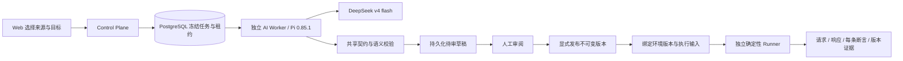
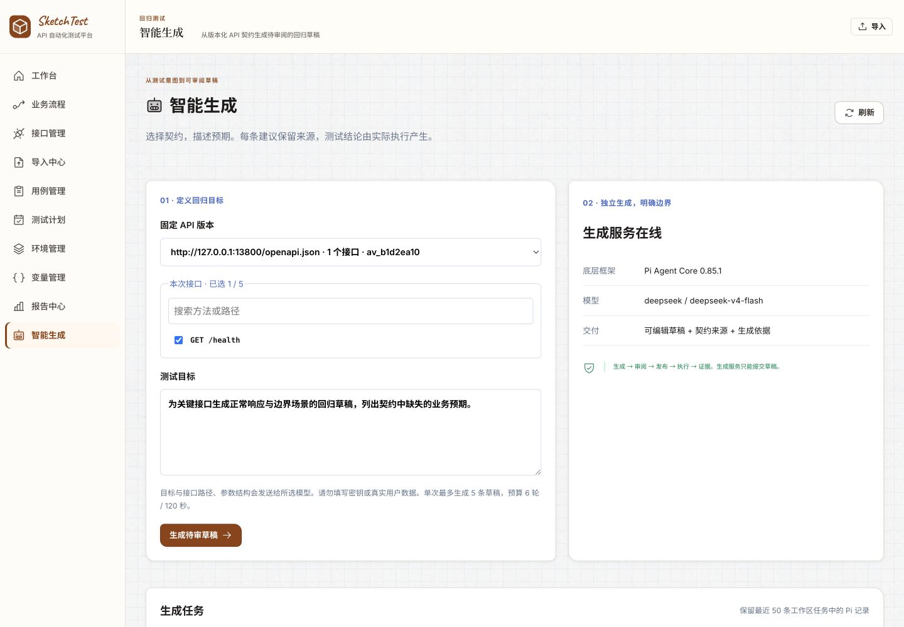
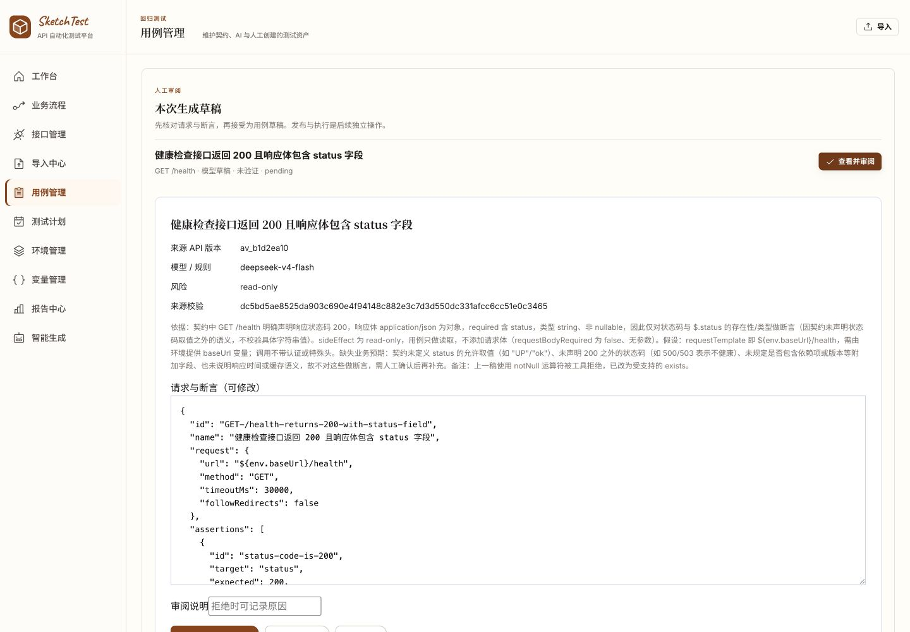
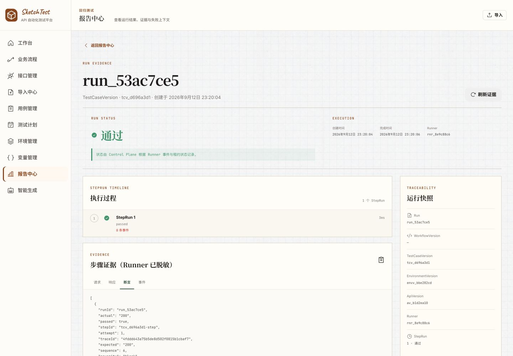
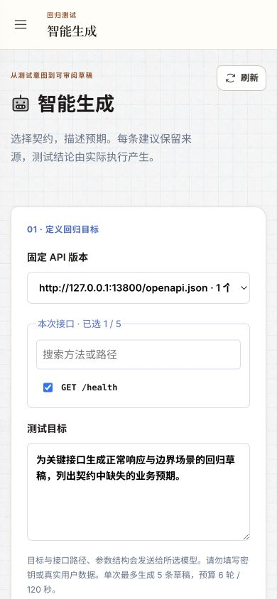
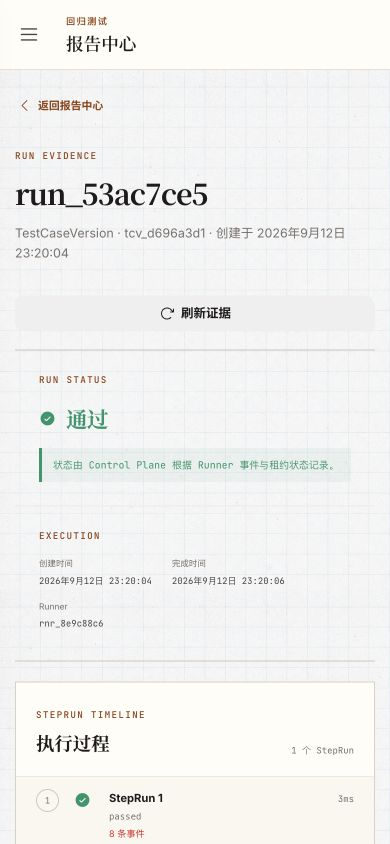

# Pi 集成与可信回归闭环验收

日期：2026-09-12。对象：当前本地工作树，测试/研发团队。

## 产品结果

本次把“从 API 契约得到可信回归”的核心路径落成了实际功能：导入并固定 API 版本 → 描述目标与选择接口 → Pi 生成待审草稿 → 人工核对完整请求、断言和依据 → 接受为未发布用例 → 显式发布 → 固定环境版本执行 → 查看 Runner 证据。

保留原有蓝图视觉体系、业务流程编辑器和确定性 Runner。工作台给出起步路径；全局无上下文的保存/运行入口已移除；未测量的覆盖率显示“未统计”；变量页读取真实版本来源；环境页支持基础地址和变量版本。用例页把审阅队列放在资产列表之前，键盘与视觉顺序一致。

这完成了本次 Pi 接入及核心产品迭代。更广的业务流程自动推导、组织级模型预算、企业级部署验证仍有明确边界，不以本次健康检查替代这些能力的验收。

## 实际架构

选型依据、官方来源与替代方案见 [ADR 0002](../adr/0002-pi-generation-harness.md)。实际依赖锁定 `@earendil-works/pi-agent-core` 和 `@earendil-works/pi-ai` 0.85.1，而非仅使用 Pi 名称包裹普通模型调用。

- CP 保存冻结来源、输入 hash 和目标模型；Worker 通过专用凭证领取租约，不能访问用户/Runner 路由。
- Pi 工具限于读取提供的契约投影和提交草稿，没有 shell、文件系统或目标 API 执行工具。
- 默认每次最多 5 条草稿、6 轮、120 秒，独立子进程承担强制超时/取消；没有在线 Worker 时不能创建 Pi 任务。
- 过期租约可重新领取；旧 token 无法回写；相同结果重复提交幂等；取消/重试均持久化。
- CP 再次校验来源、hash、模型、方法、URL、风险等级及契约状态码断言。人工接受与发布是两个独立事务，重复发布保持原发布人和时间。
- 直接运行固定环境版本，解析 `${env.*}` 后重算执行计划 hash。缺失变量、非 HTTP(S) 地址、需审批环境及有 Runner 标签约束的环境在入队前被拒绝；写操作需要明确确认。

## 真实模型与浏览器验收

使用用户指定的 `deepseek / deepseek-v4-flash`，实际调用 DeepSeek 服务。按 [DeepSeek 官方公告](https://www.deepseek.com/en/news/deepseek-v4-1-flash/)，该兼容别名现指向 V4.1 Flash；记录的是请求模型名，不声称冻结供应商底层权重。

验收只向模型提交本地合成健康接口契约和测试目标。模型密钥仅保存在本地忽略文件中，未写入源码、截图或验收记录；CP 和 Web 不持有模型密钥。

| 证据 | 最终验收值 |
|---|---|
| API 版本 | `av_b1d2ea10` |
| 来源 hash | `dc5bd5ae8525da903c690e4f94148c882e3c7d3d550dc331afcc6cc51e0c3465` |
| 生成任务 | `gj_fb42a5ae`，领取 1 次，完成 |
| Prompt 版本 | `1.1.0` |
| 用例 | `tc_9f0ffd6e`，健康检查接口返回 200 且响应体包含 status 字段 |
| 发布版本 | `tcv_d696a3d1` |
| 环境版本 | `envv_bbe282cd`，基础地址 `http://127.0.0.1:3800` |
| Runner | `rnr_8e9c88c6` |
| 运行 | `run_53ac7ce5`，passed，1 个步骤，8 条步骤事件 |
| 断言 | 状态码为 200；`$.status` 类型为 string；`$.status` 存在：三项均通过 |

模型第一次提出不支持的 `notNull` 操作符，被工具契约拒绝后在预算内改成 `exists`。这验证了实际 Pi 工具循环和纠错，而非直接信任模型输出。草稿用中文说明依据，并指出契约未声明枚举、业务状态或性能阈值。

上述任务由浏览器创建、审阅和发布，再从用例页发起运行。报告中可看到真实请求地址、响应、逐条断言结果及 API/用例/环境版本。此前另一次浏览器运行 `run_86fdded6` 也通过；它使用较早的 prompt，不作为最终生成质量样例。

## 自动检查

- `pnpm turbo run lint check test build --force --concurrency=4`：72/72 任务通过，18 个包/应用合计 **1,011 个测试通过**；其中 CP 430、Web 137、AI Worker 17、Generation Protocol 11。保留既有非阻塞 React act/CSS lint 警告，不将其报告为零警告。
- `pnpm --filter @sketch-test/control-plane exec tsx scripts/ai-generation-e2e.ts`：真实 PostgreSQL 独立临时 schema 的 7 组验收通过。覆盖迁移重入、凭证和工作区隔离、并发领取、租约过期/旧 token、输入与结果追溯、重复提交、并发审阅、显式不可变发布、环境绑定/限制、取消/重试与次数耗尽。脚本清理自身临时 schema。
- `docker compose --env-file .env.example --profile ai config -q`：配置校验通过。
- 桌面 1440×1000 与移动 390×844 实际页面检查；生成页、报告页在窄屏无页面横向溢出。截图如下。

旧 EnvironmentDialog 测试替身忽略 Zustand selector，每次返回新对象，导致效果钩子循环和测试进程内存耗尽。已改用真实 store 状态并增加保留审批/Runner 限制的版本保存测试；修复后完整默认并发测试通过，无需提高堆限制或跳过测试。

## 画面证据

### 智能生成

### 完整草稿审阅

### Runner 执行证据

### 移动端

## 运行与剩余边界

本地入口：[智能生成](http://127.0.0.1:5173/agent) · [最终报告](http://127.0.0.1:5173/reports/run_53ac7ce5)。启动参数、容器 profile 与配置说明见 [AI Worker README](../../apps/ai-worker/README.md)。

本机 Docker daemon 未运行，因此本轮未构建/启动新增 AI Worker 镜像，也未重跑依赖 Docker 的完整产品恢复/Compose 发布验收。不能把旧 STATUS 中历史容器验收视作本次镜像验证；本次已验证的是本地独立进程与真实 PostgreSQL/模型/Runner 链路。

AI 当前生成单接口用例草稿，跨步骤业务流程仍用已有编辑器。未实现组织级费用硬上限、通用敏感数据识别或每工作区独立 Worker 凭证；调用者应只提交适合所选模型处理的测试目标。契约投影有尺寸限制，大型/复杂来源需缩小选择范围。没有依据的业务预期必须补充来源并人工审阅，不能由生成成功推出业务可靠。
