# SketchTest：从资产管理走向可信业务回归

日期：2026-09-12。对象：当前本地工作树。用户已确认主要服务测试/研发团队。

## 结论与本次交付边界

产品应帮助团队回答：**这次变更后，哪些关键业务仍然可靠；哪些失败值得阻断发布；依据在哪里？**
目前已有接口导入、版本化流程、独立执行、证据和计划等基础，适合迭代，无需推倒底层重写。
最需要重新设计的是任务入口、资产之间的衔接、草稿审阅和结果解释。

第一轮审视后已继续完成 Web → Pi/DeepSeek → 人工审阅 → 显式发布 → 环境绑定 → Runner 证据的真实闭环；覆盖率占位、演示变量、环境配置和报告断言展示也已修正。
最终实现、实测 IDs、截图和当前边界见 [Pi 集成验收](2026-09-12-pi-integration.md)。以下审视表保留最初现场记录；后续规格仍用于描述更广的产品方向，不表示所有长期目标均已实现。

## 从第一性原理推导

1. 用户真正交付的是业务可靠性判断。端点数、用例数和 Agent 对话数只能作为过程数据。
2. 判断成立需要明确预期、固定输入、真实执行、可追溯证据。缺少任一项，都不能显示“业务健康”。
3. API 约定只能证明接口行为的一部分。退款上限、订单状态迁移、幂等性等业务预期，必须来自业务依据或人工确认。
4. AI 可以降低理解和编写成本，却不能把推测变成已验证事实。生成、审阅、发布、执行需要不同状态。
5. 回归需要稳定，模型推理允许探索。将推理放在独立 AI Worker，执行继续由确定性的 Runner 完成。
6. 调用外部系统可能留下数据或触发动作。风险、目标环境、清理步骤与凭证应在发布/运行前明确。
7. 团队协作需要共同的版本和审阅记录。聊天记录不能替代 WorkflowVersion、TestCaseVersion 和 RunSnapshot。

这与现有七项产品原则一致。保留不可变版本、contract-only seams、CP/Runner/AI Worker 独立进程，以及蓝图风格的流程编辑器。

## 审视证据与范围

本轮在内置浏览器实际打开全部十个导航入口，记录空工作区的首次使用路径。桌面检查采用 1440 × 1000，
最初工作台还记录了约 688 像素宽的自然窗口。截图来自本轮，不使用旧测试记录当作当前证据。

| 步骤 | 当前健康度与证据 | 产品影响 | 建议/本次状态 |
|---|---|---|---|
| 1 工作台 | 需改进：零值卡片与多个空面板，没有完整起步路径；各页通用保存/运行 | 用户不知道如何获得第一次可信结果；状态可能误导 | 已增加三步入口，移除全局操作，修正状态统计 |
| 2 导入中心 | 部分可用：URL 导入有标注和禁用状态；直接展示 CP、API Version 等实现术语 | 文件/粘贴入口与接口管理分离，导入后的下一步不清晰 | 建议统一来源入口，导入后进入接口检查与流程起步 |
| 3 业务流程 | 入口可用：明确的新建操作；空态只要求添加请求地址 | 容易做成请求串联，缺少业务目标和预期 | 建议创建时先填写业务目标、关键预期，再编排请求 |
| 4 用例管理 | 需改进：空态只解释来源，没有直接行动；空列表使用绿色勾 | 容易把“没有资产”感知为成功；草稿队列难找 | 建议将待审阅与已发布分开，并提供来源入口 |
| 5 测试计划 | 结构清楚：版本、成员、门禁、定时规则可辨；空态引导一个关键流程 | 有利于业务回归；但概念数量仍多 | 保留版本机制，默认先完成手动回归，再配置计划 |
| 6 报告中心 | 空态清楚，状态筛选较完整；本次没有运行记录 | 无法据此判断失败定位与重放体验 | 建议结论→失败步骤→预期/实际→原始证据；待带数据验证 |
| 7 AI Agent | 原来是静态未配置说明，没有实际能力探测 | 把部署状态判断和实现细节留给用户 | 已改成真实的“页面未连接”说明与现有规则生成入口 |
| 8 接口管理 | 需改进：无接口时显示“未找到匹配”并提示调整筛选；平均覆盖率显示 0% | 无数据与筛选无结果混淆，覆盖率可能被误认为测量结果 | 代码确认 coverage 固定为 0；应改为未计算并补真实关联指标 |
| 9 环境管理 | 需改进：空白主区域，仅有新建按钮 | 缺少环境作用及下一步解释 | 应展示环境起步空态与版本/Secret 引用说明 |
| 10 变量管理 | 需改进：真实 Secret 功能与四行“演示”变量同页 | 虽有演示标识，仍可能混淆可执行配置与预览 | 将演示移入显式预览模式或完成真实版本 API；不算已完成生产能力 |

### 1. 工作台（迭代前）

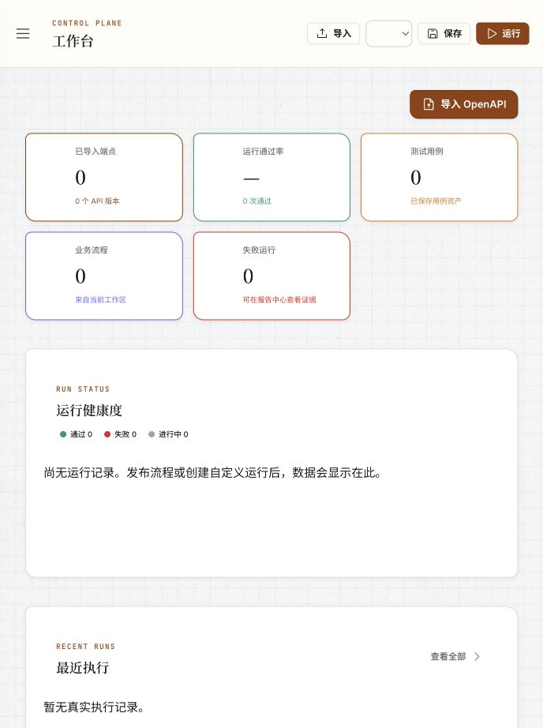

### 2. 导入中心

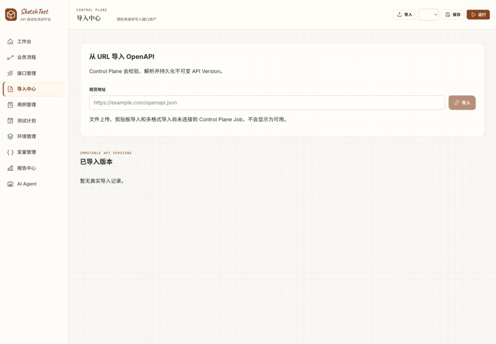

### 3. 业务流程

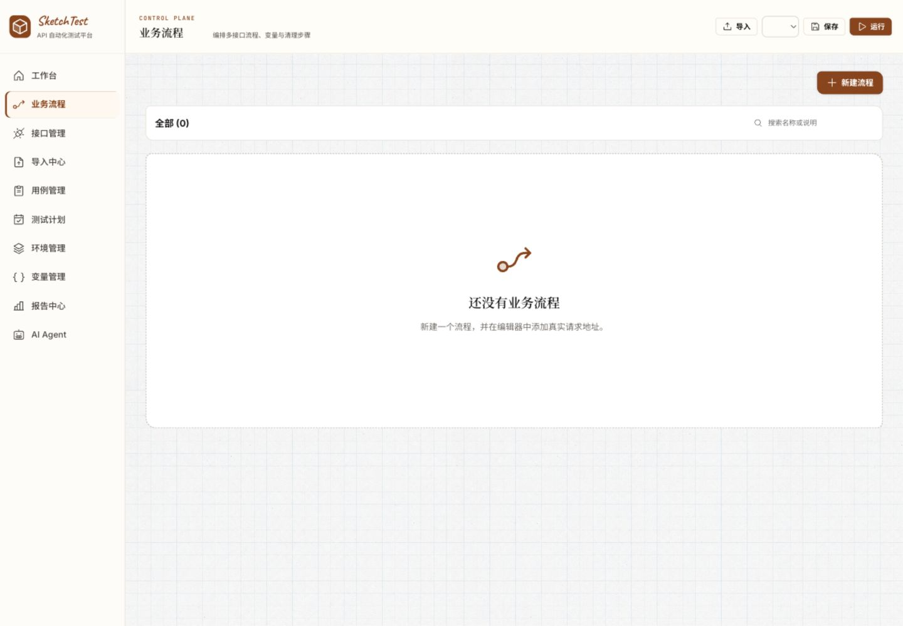

### 4. 用例管理

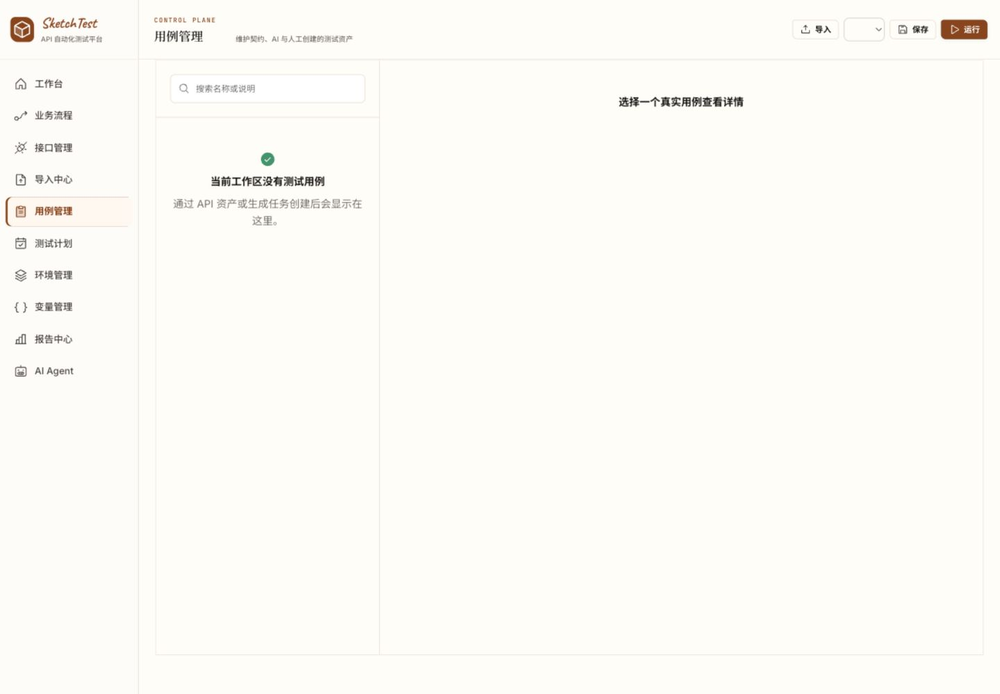

### 5. 测试计划

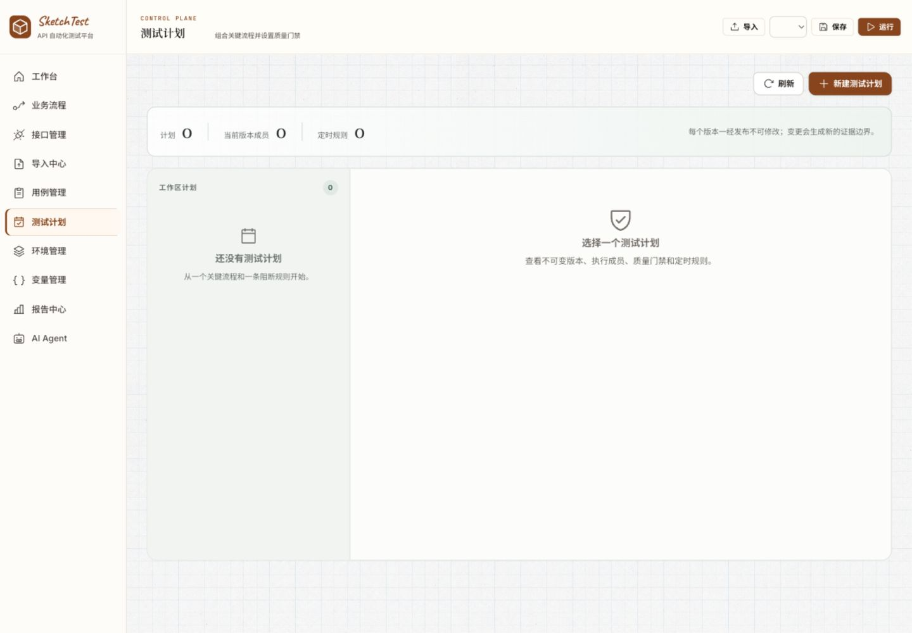

### 6. 报告中心

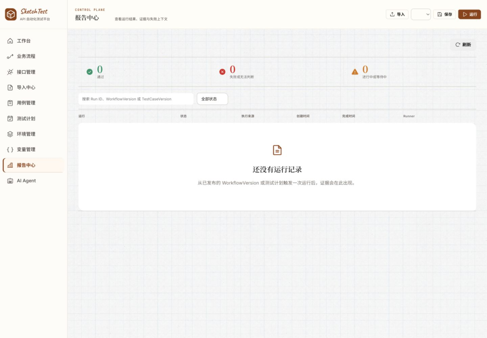

### 7. AI Agent（迭代前）

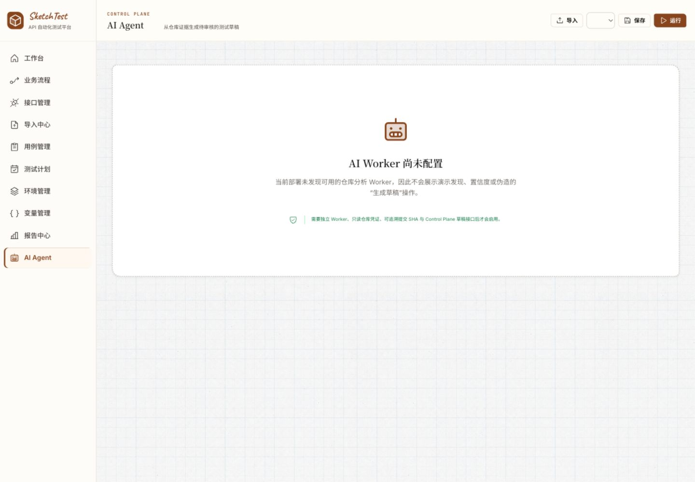

### 8. 接口管理（补查）

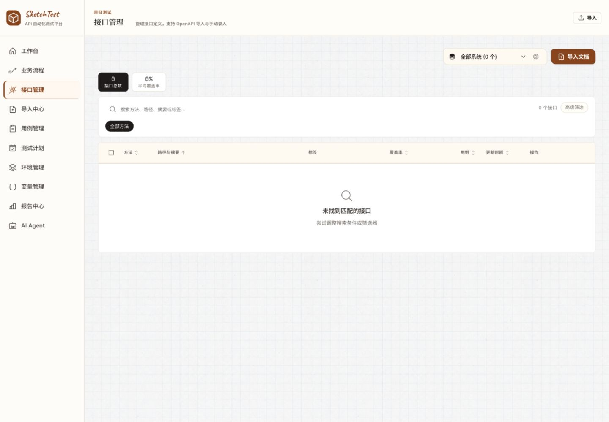

### 9. 环境管理（补查）

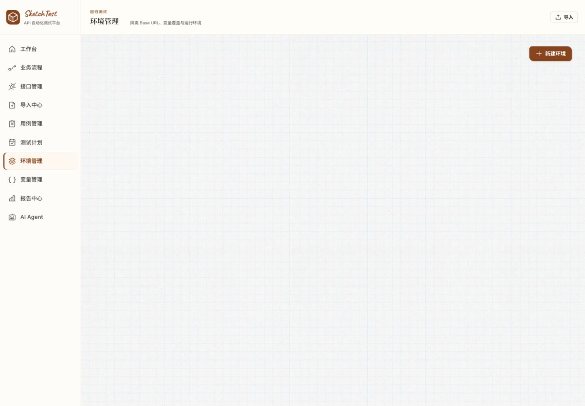

### 10. 变量管理（补查）

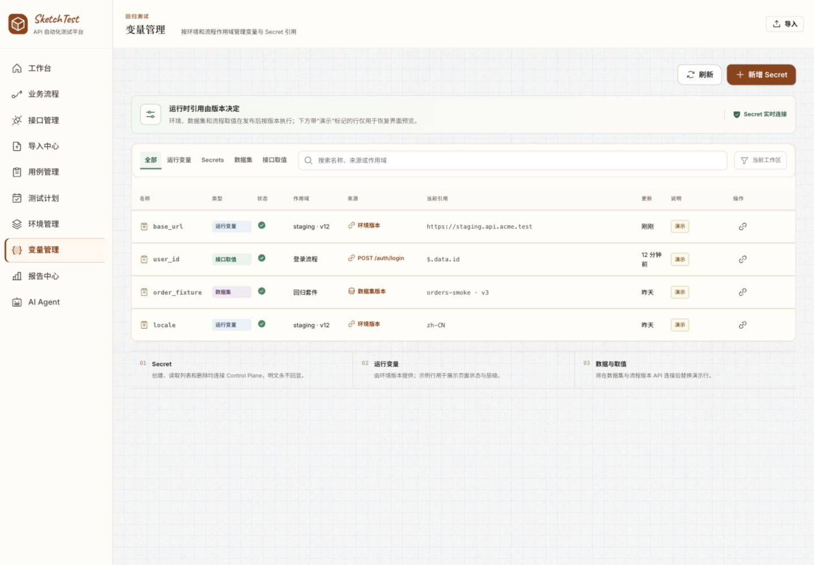

## 代码审视补充

这些发现来自代码，不能等同于已经完成的带数据浏览器审视：

- `AppLayout.tsx` 在所有路由绑定流程 store 的保存/执行和快捷键。保存没有 await 就提示成功；
  离开编辑器后仍可能操作旧流程。编辑器本身已有保存、发布和运行按钮，因此本轮去掉 shell 的重复操作和快捷键。
- `Dashboard/index.tsx` 把 passed/failed 以外的状态全部映射为进行中；已取消、失联和无法判断因此被误报。本轮修正。
- 工作台将各 ApiVersion 端点数量相加，跨版本会重复计算。本轮改名“端点版本记录”，不冒充唯一端点或覆盖率。
- 工作台所有流程卡片都带 healthy 样式，与最新执行结果无关。本轮去掉未经证据支持的健康提示。
- `MetricCard` 是没有事件的 button。本轮改为展示元素，避免无效键盘焦点。
- `ApiManagement/index.tsx` 将接口 coverage 初始化为固定 0。现有“平均覆盖率”没有本轮验证的测量依据；应先改为“尚未计算”，随后接入 TestCaseVersion/RunSnapshot 的真实关联。
- `generation.routes.ts` 当前只接受 example/schema/status-codes 规则策略；`AgentPage` 不发起 Worker 能力请求。
- `Cases/index.tsx` 用 `generationJobId` 查询参数打开某次生成的草稿；审阅列表主要显示名称、来源和置信度。
  应补完整请求/断言 diff、证据与风险，并建立跨任务的待审阅入口。
- 当前项目说明与实际代码不完全一致：Web 已有十个入口、guest 会话和变量/环境页，旧状态文档仍描述更窄的已验证范围。
  本轮不把历史通过记录当成当前功能完成证据。

## 目标信息架构

| 导航层 | 用户要完成的事 | 内容与迁移 |
|---|---|---|
| 工作台 | 决定今天先处理什么 | 待处理失败、待审阅草稿、缺少验证的关键流程、第一次回归引导 |
| 业务流程 | 定义必须正常工作的业务 | 目标、关键预期、步骤、变量、清理、版本、最近一次有效运行 |
| 回归执行 | 复用一组检查并决定是否阻断 | 现有测试计划、门禁、环境、调度、运行列表 |
| 测试资产 | 找到与维护可复用输入 | 接口/来源/用例，导入成为此处的动作；草稿审阅可从工作台直达 |
| 环境与设置 | 配置执行所需条件 | 环境、变量/Secret 引用、Runner、成员权限、AI provider 配置 |

上述分组是目标方案，当前路由未做破坏性迁移。AI 主要出现在“为此流程补测试”“解释此失败”“根据此变更更新草稿”等上下文动作中。
在持久任务和审阅链路完成前，不把一个空聊天页作为产品主入口。

## 核心任务闭环规格

### 首次建立可信回归

准备 API 来源 → 确认关键业务目标 → 选择接口并编排 → 添加明确断言和清理 → 审阅草稿 → 发布固定版本 → 选择环境运行 → 查看证据。

- 接口导入完成页展示解析诊断、来源版本和下一步“建立业务流程”。不在导入时偷偷创建演示流程。
- 新建流程先收集名称、业务目标、关键预期。复杂分支、数据集和定时设置渐进展开。
- 发布前校验未绑定变量、缺少断言、未设置清理与高风险步骤；具体风险规则由现有 policy/编译器执行。
- 运行前明确版本、环境、Runner 可用性、数据输入和副作用。未发布不能直接作为 CI 回归依据。
- 结束后优先给出“通过/失败/无法判断”及适用范围。未知、取消、失联不能被当作通过。

### 团队日常处理失败

工作台待处理项 → 业务流程与触发变更 → 第一处失败步骤 → 预期/实际差异 → 脱敏请求响应 → 对应冻结版本 → 决定修复、补证据或重放。

重放固定测试输入与版本，并提示外部系统状态可能不同。AI 解释必须引用步骤和证据；
“怀疑原因”与已观察事实分开展示，不能把解释文本改写为 RunEvent 的执行结论。

### AI 辅助审阅

用户明确业务目标与 API 范围 → 创建 GenerationJob → Pi Worker 读取受限证据 → 生成 GeneratedDraft →
平台校验与展示差异 → 人工修改/接受/拒绝 → 走现有发布路径。

草稿至少展示来源 ApiVersion、端点、原始依据、请求与断言、风险等级、缺失信息、模型/提示版本。
置信度若没有校准依据，不展示百分比。本轮 Worker 输出 rationale，不输出自行发明的置信度数值。

## 关键状态与文案规则

| 状态 | 应展示 | 主行动 |
|---|---|---|
| 空工作区 | 尚未建立回归；说明获得首次结果的步骤 | 准备接口 |
| API 加载失败 | 当前数据不可用，不能解释成 0 个失败/100% 通过 | 重试或恢复会话 |
| 草稿生成中 | 已读取的来源、当前阶段、预算、取消 | 查看进度/取消 |
| 生成失败 | 可理解的失败原因，已完成草稿是否保留 | 重试；不能假装成功 |
| 待审阅 | 来源与修改内容、假设、风险 | 修改/接受/拒绝 |
| 未运行 | 尚无证据 | 发布并运行 |
| 无法判断/失联 | 基础设施或证据不足，与断言失败区分 | 检查 Runner/补证据 |

## 指标与验证计划

优先指标：关键流程的有效验证覆盖。分母由团队明确标记的关键流程组成；分子要求目标环境、版本和时效范围内存在完整且可解释的执行证据。
在这些字段和来源关系完整以前，不在首页合成一个“业务覆盖率”。

辅助指标：从接入 API 到第一条有效回归的耗时、草稿人工修改后采纳率、失败定位耗时、无法判断比例、重放成功率。
区分草稿采纳和最终测试正确率，避免奖励大量低价值生成。

尚无访谈或真实团队使用数据。建议用三类任务做可用性验证：新成员首次回归、维护者补充业务断言、研发定位一次失败。
记录是否独立完成、误操作、停顿位置与耗时，再确定目标值，不编造提升百分比。

## 可访问性与验证限制

确认的优点：导航有 aria-label、表单有名称、导入空输入禁用，桌面文字与操作分区可辨。
本轮修复无行为的指标按钮，以及全局快捷键误操作。

仍需测试：浅色说明文字的对比度、小图标点击区域、弹窗焦点限制和恢复、屏幕阅读器阅读顺序、
编辑器缩放/连线的键盘替代路径、200% 缩放、长流程和移动端。
截图不能证明 WCAG 合规。

本轮没有在审视工作区创建接口/执行请求；发布、运行中断、失败详情、草稿编辑等数据状态尚未完成端到端体验验证。
浏览器热更新期间遇到一次 Missing Authorization header，刷新后恢复；这说明会话失效恢复也需要纳入后续路径测试。
本轮已让工作台加载错误时隐藏结果指标，避免把错误表现为空成功状态。

## 落地顺序与验收

| 阶段 | 范围 | 验收 |
|---|---|---|
| 本轮 | 起步引导、全局动作移除、状态语义、Pi 契约与独立验证 | Web 测试、Pi 真循环测试、类型/构建、浏览器截图 |
| 先修正信任缺口 | 未计算覆盖率、变量演示隔离、环境空态 | 未测量不显示百分比、演示不混入执行配置、空态指向真实动作 |
| 下一纵向切片 | CP→Worker→GeneratedDraft→Web 审阅 | 带鉴权租约、来源投影、断点恢复、幂等提交；真实模型评估；用户可以完成一次审阅 |
| 后续 | 业务流程目标与断言引导，统一资产入口 | 新用户无需理解后端术语即可完成首次回归 |
| 后续 | 失败证据工作区、上下文 AI 解释、变更影响 | 结论能定位到冻结版本与步骤证据；推测与事实可辨 |

## 本轮迭代后的工作台

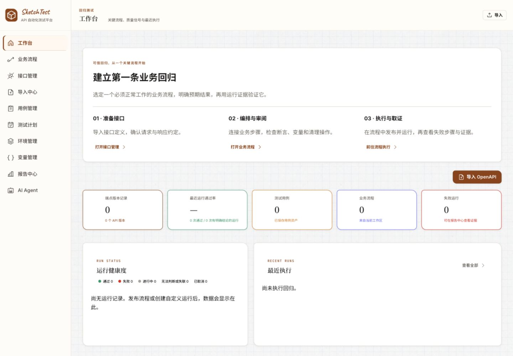

保留现有蓝图背景、纸张面板和克制配色。当前优先解决任务路径与状态可信度，未另起一套视觉系统。

## 窄屏复核

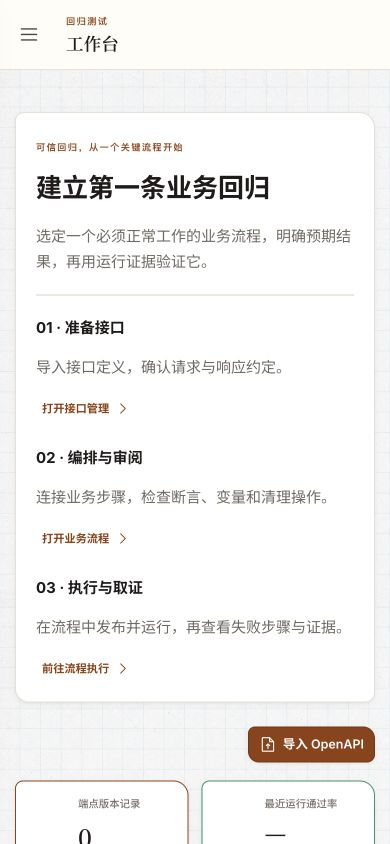

390 × 844 下三步入口按单列重排；关闭导航后无遮挡，DOM 实测 documentWidth = viewportWidth = 390。
这仅覆盖工作台断点，不等于整个应用的移动端验收。
