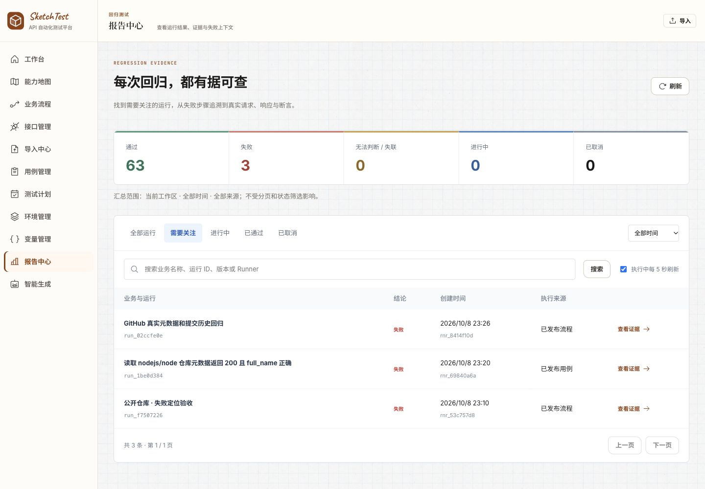
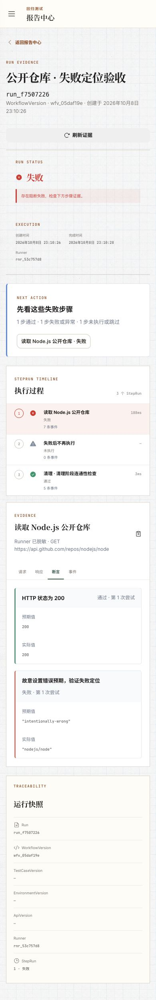
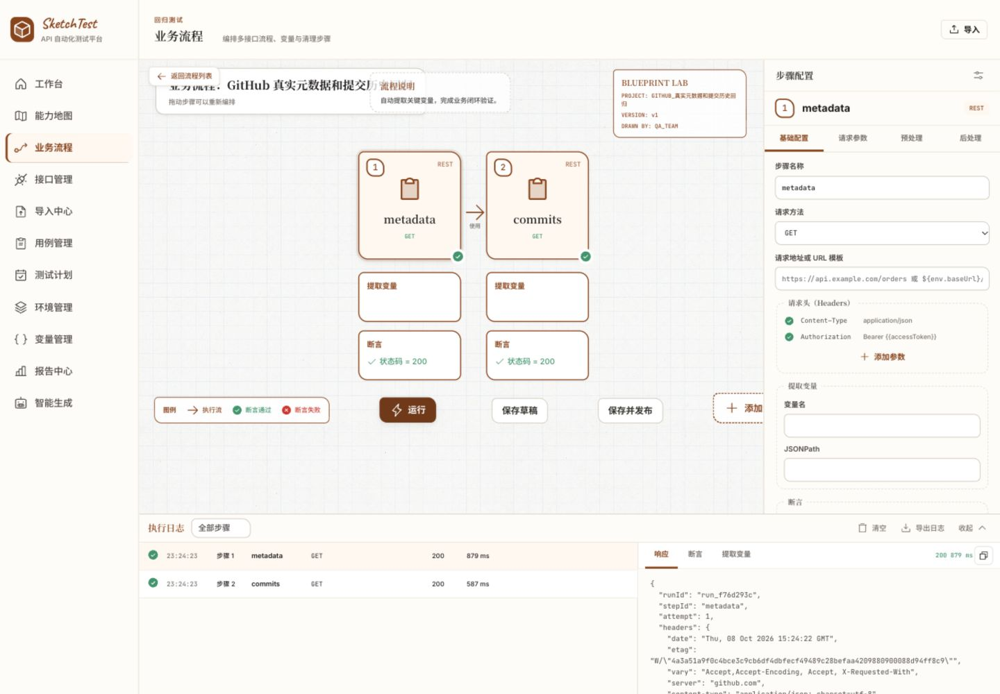
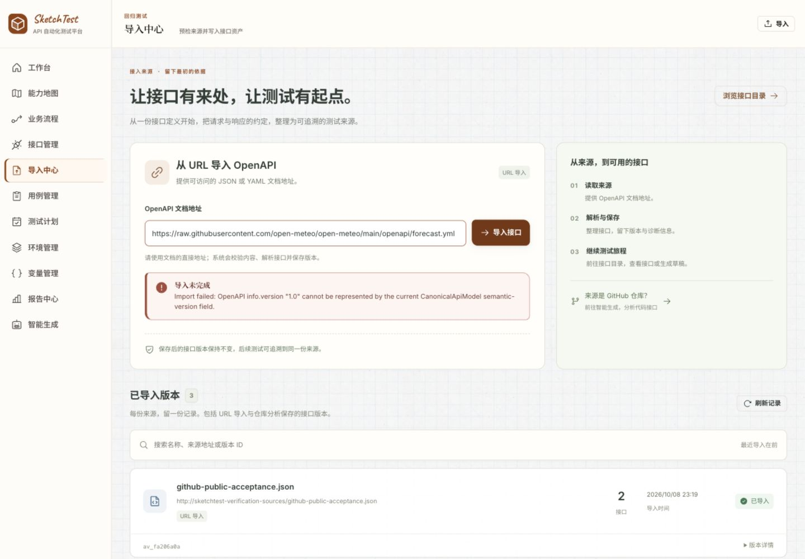

# SketchTest 本机平台完整验收报告

验收日期：2026-10-08（Asia/Shanghai）。对象：当前工作区代码，包括已有未提交修改。**结论：主要回归链路可运行，但本轮验收不通过，尚不能认定功能完整或可用于生产。** 本轮没有修改产品代码；新增的是验收脚本、数据、截图及报告。

入口：[保留的验收平台](http://localhost:8180)。工作区：`ws_02eaec7b`，名称「2026-10-08 平台完整验收 · 公开真实数据」。

## 结果概览

| 项目 | 本轮结果 |
|---|---|
| 全量工程门禁 | `pnpm turbo run lint check test build --force`：76/76 任务，1,029 个测试通过，无缓存 |
| 部署 | 当前源码构建生产镜像，Web / Control Plane / Runner / AI Worker 为独立容器，PostgreSQL 18 + MinIO 持久卷 |
| 真实接口资产 | 3 个 ApiVersion、62 条接口记录；其中真实 Spring 仓库 59 个接口、86 个文件，固定 Git commit |
| 真实 AI | DeepSeek `deepseek-v4-flash` 经独立 Pi Worker 完成 2 次真实用例生成，另完成 1 次计划生成；没有替换模型 |
| 规则生成 | 57 份待审草稿生成并保留；接受、发布与执行分别验证 |
| 执行 | 66 条持久 Run：63 passed、3 failed；没有进行中或失联 Run |
| 失败解释 | 1 条是故意设置错误断言；2 条是真实缺陷的复现。此比例不是业务测试通过率或验收通过率 |
| 报告 | 真实请求、断言预期/实际、停止步骤、独立清理步骤、分页、查询参数校验、CLI 读取通过 |
| 权限 | 匿名 401、跨工作区报告 404、跨工作区列表/汇总隔离、viewer 禁止写入通过 |
| 可观测性 | 存活/就绪、请求 ID、W3C trace、审计、Prometheus 基础指标通过；完整性校验和数据库故障处理有阻断问题 |
| 短时负载 | 100 次真实鉴权读取、并发 5、0 请求错误；客户端 P50 2.10ms、P95 8.26ms、最大 20.86ms，仅代表本机短时结果 |
| 恢复检查点 | 64 Run 的 PostgreSQL 备份恢复，68 个 S3 对象恢复后 SHA-256 一致，报告/manifest 与原环境一致 |
| 最终留存 | 全部 66 Run 的最终数据库备份、70 个 S3 对象及逐对象校验清单保留；最终备份比已实测恢复检查点多 2 条后续复现 Run |

## 优先处理的问题

### P1-01：正常运行的证据完整性校验失败

- Run：`run_84626abc`，业务执行 `passed`。
- `GET /api/runs/run_84626abc/evidence-verify` 返回 `valid:false`，7 个事件重新序列化后全部与持久 contentHash 不同。
- storedHash：`44268d69e2dad526c0907caf47c9e487ebc18c028733d8f0f6e9a0a7160595c4`。
- computedHash：`8a74f2fed923c1cf8573a671afc72ad477f9c72fb8359e6a4e2098c1e8c97209`。
- 恢复后的环境同样复现。这不证明数据被篡改；它说明当前校验无法可靠证明未篡改。
- 根因证据：入库前对 `JSON.stringify(payload)` 求哈希，入库使用 JSONB，读取后再次 `JSON.stringify`；没有采用一致的规范序列化。见 `apps/control-plane/src/modules/run/event.service.ts:42`、`:199`。
- 修复方向：定义稳定、版本化的内容规范化方式或保存原始字节；兼容已有证据，不能静默重写既有 manifest/hash。
- 证据：[逐事件哈希](integrity-event-hashes.json)、[接口结果](integrity.json)、[恢复验证](recovery-results.json)。

### P1-02：编辑器保存导入流程丢失请求，空 URL 仍可发布

- Arazzo 导入流程 `wf_64af47d8` 的 v1 `wfv_0f2d735b` 实际运行通过；浏览器点击「运行」产生 `run_f76d293c`，两步均 HTTP 200。
- 打开同一流程，URL 编辑框为空。点击「保存草稿」得到 v2 `wfv_c289c262`，原 `useTest.kind=inline` 下的真实 URL 被变成 `url:""`。
- API 仍成功发布 v2，ExecutionPlan 的两个 `urlTemplate` 均为空；`run_02ccfe0e` 实际执行 failed。
- 原 v1 保持不变；损坏的 v2 和失败运行均为验收复现资产，已保留。不要将这个 v2 当成可用回归版本。
- 根因证据：`apps/web/src/stores/workflowStore.ts:86` 只读取 `step.url`，保存时重新构造简化步骤，丢失 `useTest` 等结构；发布编译未拒绝空 URL。
- 同屏请求头显示固定 `Content-Type` / `Authorization: Bearer {{accessToken}}`，不是该流程真实请求头。「添加参数」点击前后没有变化，源代码按钮也没有处理函数，见 `WorkflowWorkspace.tsx:399`。
- 修复方向：无损读写 WorkflowDefinition；让编译拒绝空/无效 URL；请求头必须绑定真实状态。
- 证据：[定义、发布计划、失败 Run](workflow-roundtrip-defect.json)、[运行截图](10-workflow-run.jpg)、[保存后截图](11-workflow-saved-draft.jpg)。

### P1-03：AI 路径参数生成与运行时绑定不兼容

- 输入是本轮基于真实 GitHub 响应编写的最小 OpenAPI 3.2 契约，路径 `/repos/{owner}/{repo}`。
- CanonicalApiModel 将路径表达为 `/repos/:owner/:repo`；生成模板转换函数只识别 `{name}`。
- 真实模型草稿 `draft_f592aeaa` 的 URL 为 `${env.baseUrl}/repos/:owner/:repo`；即便环境已配置 owner=nodejs、repo=node，仍请求 `https://api.github.com/repos/:owner/:repo`，`run_1be0d384` failed。
- 审阅时尝试修正变量表达式被拒绝：`Review cannot change the source endpoint or downgrade its risk`。
- 接受后创建新的人工修正版，使用 `${env.baseUrl}/repos/${env.owner}/${env.repo}`，`run_a170cee5` passed。原草稿、原版本与失败证据未被覆盖。
- 根因位置：`packages/contracts/generation-protocol/src/index.ts:122`；审阅限制在 `generation.service.ts:1106`。
- 证据：[真实模型草稿](github-ai-draft-review.json)、[失败与人工修正对照](ai-execution-results.json)。

### P1-04：PostgreSQL 断开使 Control Plane 异常退出

- 仅停止本轮独立 PostgreSQL 容器，Control Plane 抛出未处理的 BoundPool `error`，`/ready` 和 `/health/live` 都连接失败，而不是持续返回受控降级状态。
- Docker 自动重启计数增加到 1；数据库恢复后平台恢复就绪，已有数据仍可读。
- 这证明重启后可恢复，但不代表优雅处理数据库故障。
- `apps/control-plane/src/db/db.ts:9` 的 Pool 没有注册错误处理。
- 证据：[中断探测](postgres-down.json)、[脱敏异常摘录](postgres-crash-redacted.txt)、[恢复结果](availability-results.json)。扫描 CP 日志未找到本轮配置的密钥值。

### 能力缺口：定时规则未形成自动派发闭环

- 创建每分钟规则并启用，跨分钟观察 75 秒，Run 数量从 61 到 61，没有派发；测试后已停用。
- 手动 `trigger-now` 已真实执行成功。代码存在 `getDueSchedules`，但当前应用源码没有调用它的调度进程。
- 能力地图也明确提示「自动调度待验证，启用规则不代表会到点运行」。应按未完成功能处理，不能将配置成功当成自动执行成功。
- 证据：[定时观察](schedule-observation.json)。

### P2：真实 OpenAPI 兼容性与界面反馈

- Open-Meteo 官方原文件被拒绝：`info.version: '1.0'` 不满足平台当前语义版本字段；单独改为 `1.0.0` 后又被路径级 `servers` 拒绝。
- 官方来源原件已原样保存。为继续验证适配边界，另存**明确标注的派生文件**：保留原 version 扩展，将版本规范化并将单路径的 servers 提升到根级；该派生文件导入成功。此结果不算“官方原件直接导入通过”。
- 官方较大的天气端点无法进入当前有界 AI 投影，返回 400。没有调用天气业务 API，也没有把此项写成成功执行。
- URL 失败提示可见，不生成假成功记录，但显示英文内部类型名，可读性有改进空间。
- 证据：[官方原件](open-meteo-original.yml)、[版本规范化后失败](import-results.json)、[派生契约](open-meteo-compatible.json)、[成功导入](weather-compatible-import.json)、[界面错误](13-import-error.jpg)。

### 可观测性范围不完整

- `/metrics` 提供进程运行时长、按 method/route/status 的请求计数、累计时长；路由标签被规范化，没有把 Run ID 放入标签。
- 当前没有请求耗时 histogram，因此无法直接从现有指标计算服务端 P95/P99。
- 当前 Compose 没有运行 Prometheus/Grafana/Alertmanager，也没有告警投递链路的实测证据；仓库只有告警规则文件。不能判定监控采集、看板、通知闭环已可用。
- 请求 ID、W3C traceparent 和 Runner 事件关联、Secret 解密审计已验证。尚未验证外部链路采集器、长期日志存储、SLO 或外部告警。
- 证据：[运行指标样本](metrics.prom)、[重启后的最终指标](metrics-final.prom)、[审计](audit-evidence.json)。

## 功能验证矩阵

| 功能 | 结论 | 证据/边界 |
|---|---|---|
| 当前代码 lint/check/test/build | 通过 | 76 任务、1,029 tests，见 quality-gates-summary.json |
| 全新生产模式 Compose 启动 | 通过 | 独立项目、当前源码镜像、持久数据卷 |
| Workspace / owner bootstrap / login / guest | 通过 | 持久验收 workspace，本机 guest 只绑定这一工作区 |
| viewer 权限、匿名拒绝、跨工作区隔离 | 通过 | 真 PostgreSQL + HTTP；isolation.log、report-regression.json |
| GitHub Spring 代码发现 | 通过 | 59 endpoints、86 files、固定 commit、72 条诊断保留 |
| 官方 OpenAPI 直接导入 | 未通过 | Open-Meteo 原文件两项兼容限制 |
| 受支持 OpenAPI 3.2 → Arazzo 1.1 | 通过 | 自编最小真实 GitHub 契约，源文件有明确说明 |
| 接口检索、详情、派生 YAML | 通过 | 浏览器搜索 `/api/staff` 返回 2/59；详情/YAML 可读 |
| 规则生成 | 通过 | 等待异步完成后得到 57 drafts；未把初次空列表误判为产品缺陷 |
| 真实 AI 生成及来源追溯 | 部分通过 | Worker/模型/队列/来源通过；路径变量执行失败 |
| 审阅 → 用例草稿 → 发布 | 通过 | 未发布 TestCaseVersion 运行被拒绝；已发布版本保持不变 |
| 真实单用例环境绑定执行 | 通过 | `run_697cf472`，GitHub 实际 HTTP/JSON 断言 |
| 已发布 Workflow 执行、浏览器执行 | 通过 | API 与 Web 均执行 GitHub 实际请求 |
| Workflow 编辑后保存再发布 | 未通过 | useTest 丢失，空 URL 可发布后执行失败 |
| 工作流请求头编辑 | 未通过 | 固定展示内容，添加参数无动作 |
| TestSuite / quality gate / 手动触发 | 通过 | 实际 published workflow 被调度执行 |
| AI 计划生成、编辑保存、明确发布 | 通过 | 1 个真实模型计划；草稿 gap 不进入执行成员。语义仍需审核 |
| 定时自动触发 | 未完成 | 跨分钟没有自动派发，已停用验收规则 |
| EnvironmentVersion | 通过 | API 创建；UI 保存 v3；此前 Run 仍固定 v2 |
| DatasetVersion | 通过 | Node.js 公开真实响应快照导入 1 行 JSON 数据集 |
| Secret | 通过 | 列表不回显明文，Runner 解密权限通道与审计关联 |
| Policy 资源条件求值 | 通过 | production 资源条件返回 require-approval；只证明求值接口，不证明所有执行入口强制采用策略 |
| 报告成功/失败/清理/未执行步骤 | 通过 | 真 GitHub 响应 + 故意错误断言；不是模拟结果 |
| 报告分页/搜索/参数校验 | 通过 | 55 次实际 CP health HTTP 请求，3 页无重复，越界页保留总数 |
| CLI 报告读取 | 通过 | 当前编译 CLI、真实 JWT 与持久 Run |
| 请求 ID / trace / audit | 通过 | 请求头与事件一致，审计包含请求 ID |
| 证据完整性验证 | 未通过 | 7 个 inline 事件哈希不一致 |
| S3 故障检测与恢复 | 通过 | ready 503、live 200，S3 恢复后 ready 200 |
| DB 故障恢复 | 部分通过 | 重启后恢复通过；故障时 CP 崩溃 |
| Runner 停止 / 排队 / 重启 | 通过 | pending 保留，恢复后 passed；未测试多 Runner 并发和长时间租约竞争 |
| 短时只读负载 | 通过 | 100 请求、并发 5、0 错误；不等同容量/稳定性证明 |
| DB + S3 本机恢复 | 通过 | 恢复报告/manifest一致，68/68 对象字节校验一致；原有完整性缺陷依旧存在 |
| 跨浏览器 / 完整无障碍 / 长时间压测 | 未验证 | 本轮仅 Codex 内置浏览器；不声明 WCAG 达标 |
| HAR/RAML/Postman/高级多格式导入 | 自动化测试覆盖 | 没有用真实第三方导出文件逐项做本轮 live 验收 |
| TLS / 外部密钥 / 多实例 HA / 异地恢复 | 未验证 | 本机单节点范围外 |

## 界面逐步验收

| 步骤 | 页面与操作 | 状态 | 截图 |
|---|---|---|---|
| 1 | 工作台/能力地图，观察空状态和真实工作区接入 | 可用；初次接入前截图不作为最终数据为空的证据 | 01-dashboard-initial.png |
| 2 | 接口目录，搜索并查看真实 Spring 接口 | 通过 | 02-api-catalog.jpg |
| 3 | 接口详情展开 YAML | 通过 | 03-api-definition.jpg |
| 4 | 报告“需要关注”筛选 | 通过 | 04-reports-filter.jpg |
| 5 | 失败详情，预期/实际、停止步骤、清理步骤 | 通过 | 05-failure-evidence-desktop.jpg |
| 6 | 390×844 手机报告，完整内容、无横向溢出 | 通过；仅该页该视口，不是全站无障碍认证 | 06-failure-evidence-mobile.jpg |
| 7 | 编辑并保存真实环境说明，创建 v3 | 通过 | 07-environments.jpg、08-variables.jpg |
| 8 | 查看变量/数据集版本和 Secret 掩码 | 通过 | 08-variables.jpg |
| 9 | 查看实际 AI 计划与已发布状态 | 功能通过；仍有与目标无关的待补齐项，需人工审核 | 09-ai-plan.jpg |
| 10 | 从界面运行 Arazzo 导入流程 | 通过 | 10-workflow-run.jpg |
| 11 | 原样保存该流程，检验新版本 | 未通过，无损往返失败；请求头添加按钮无效 | 11-workflow-saved-draft.jpg |
| 12 | 打开 AI 草稿完整定义和 commit/文件行号来源 | 通过；57 条草稿导致页面很长、审阅内容位于列表后 | 12-ai-review.jpg |
| 13 | 从导入界面提交 Open-Meteo 官方文档 | 按预期复现兼容失败，有明确错误反馈 | 13-import-error.jpg |

桌面流程编辑器还有标题与说明区域重叠、右侧动作被压缩的可见问题（步骤 10/11）。这轮浏览器日志工具捕获到 0 条 console warn/error；这不抵消上述实际功能失败。

## 真实数据来源与人工派生说明

1. `https://github.com/yachi666/support-roster-server`，commit `f316473c15d8564fb61eb5fdb4eb8a5c06be4939`。只分析公开代码，没有执行其部署业务端点。
2. `https://api.github.com/repos/nodejs/node` 与其 `/commits`。外部执行均为公开 GET，真实响应由 Runner 获取。本轮没有向第三方业务系统写入。
3. `https://raw.githubusercontent.com/open-meteo/open-meteo/main/openapi/forecast.yml`。官方原件原样保留，派生兼容版本分别保存。没有把派生版本伪装成原件，也没有声称实际执行天气 API。
4. `github-public-acceptance.json` 是依据已取得的真实 GitHub 响应手工编写的最小验收契约，非 GitHub 官方完整规范；Arazzo 是本轮手工编排。实际请求仍访问 GitHub，没有 mock。
5. 55 次分页验收读取本轮真正运行的 Control Plane `/health`。这是真实本地 HTTP，用于报告分页，不计为 55 次真实外部业务场景。
6. 身份、环境、Secret 掩码哨兵、策略配置是为验收创建的控制数据，不冒充真实用户资料。Secret 明文与 JWT 不出现在报告中。

Runner 当前保留脱敏 `bodyPreview`，并不保存所有完整 HTTP 响应体。已抓取的原始公开元数据单独保留在 `source-nodejs-node.json`；备份保留平台实际存储的内容。

## 数据保留与复查

- Compose 项目：`sketchtest-verification-20261008`。PostgreSQL 与 MinIO 数据卷均保留，未执行 `down --volumes`。
- 当前平台：[http://localhost:8180](http://localhost:8180)，CP：[http://127.0.0.1:3812/ready](http://127.0.0.1:3812/ready)。本机 guest 已绑定验收工作区，方便直接查看留存资产。
- 独立恢复环境 CP：[http://127.0.0.1:3813/ready](http://127.0.0.1:3813/ready)，对应 64 Run 恢复检查点；无 Runner 向恢复库取任务。
- 完整资产 ID：[retained-inventory.json](retained-inventory.json)。最终 66 Run，3 ApiVersion，5 Workflow，3 TestCase，59 份 GeneratedDraft（57 规则 + 2 AI）。
- 非公开配置与访问凭据：仓库 `.services/verification-2026-10-08.env`、`.services/verification-access.json`，权限 0600、被 gitignore 排除。
- 恢复检查点备份：`.services/verification-backups/2026-10-08/platform.dump`、`objects/`。
- 最终完整备份：`.services/verification-backups/2026-10-08/platform-final.dump`、`final-objects/`，70 个对象及 SHA-256 已保存；恢复桶 `verification-20261008-final-restore` 的 70 个对象也逐字节核对通过。
- 恢复检查点对象清单：[storage-recovery-manifest.json](storage-recovery-manifest.json)；最终对象清单：[final-storage-manifest.json](final-storage-manifest.json)。
- 原始验证日志：仓库 `logs/verification/2026-10-08/`。当前报告目录内脚本为本轮验收记录，执行它们会继续创建资产，非无副作用的重复检查。
- 规则 `sched_19858afb` 最终 disabled。两次真实 AI 用例生成和一次计划生成均完成；未留待运行的验收任务。

首次脚本中曾使用错误的 `/integrity`、`/trigger` 路由及 `effect` 返回属性，或在规则异步完成前读取草稿。随后使用真实路由 `/evidence-verify`、`/trigger-now`、`decision` 并等待完成复测。上述脚本错误不计为平台缺陷，最终结论以本报告矩阵及对应复测证据为准。

未新建 GitHub issue/PR，未发布网站，未修改产品源码。修复后建议优先复测四项 P1，再验证定时派发和可观测性闭环，然后重跑当前门禁与真实数据链路。
