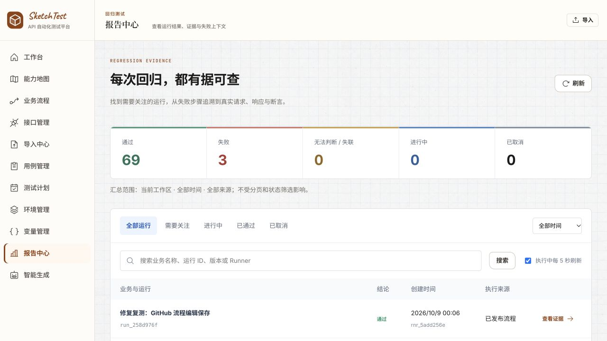
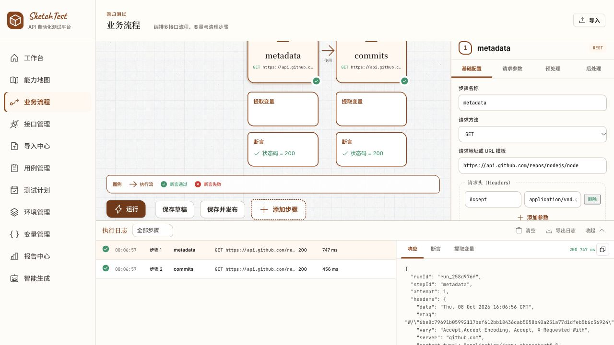
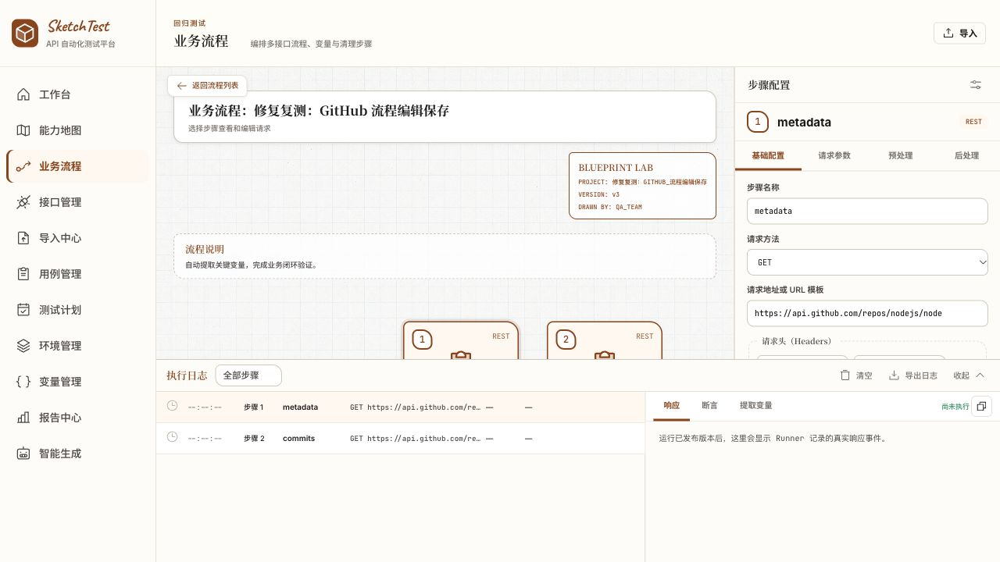
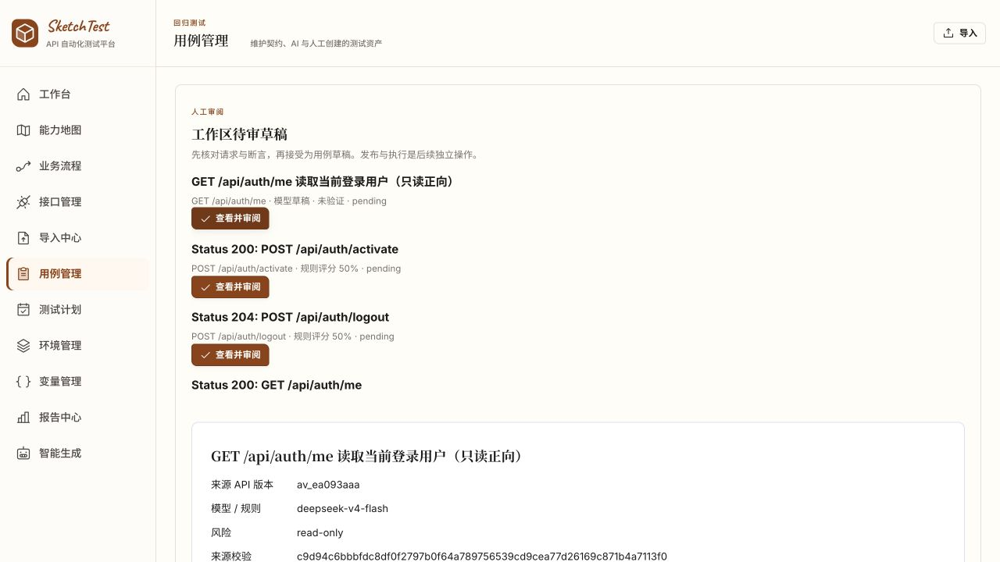
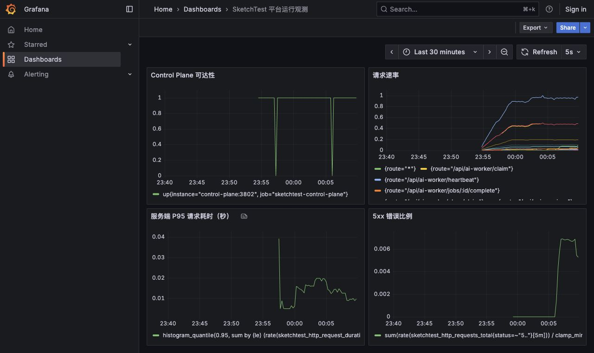

# SketchTest 缺陷修复与真实数据复测

时间：2026-10-08 至 2026-10-09（Asia/Shanghai）。对象：本机保留的验收平台与当前工作区代码。

**结论：本轮已复现的四项 P1 缺陷修复完成，新增的 6 条真实运行全部通过，相关功能与故障恢复复测通过。** 定时派发、官方文档导入、监控采集/看板/本地告警闭环也已完成实测。历史原始数据和失败证据保持不变。本结论针对本轮修复项，不将单机验收表述为生产容量、长期稳定性或所有格式/浏览器的全面认证。

## 可直接使用的入口

- [本机平台](http://localhost:8180)，沿用工作区 `ws_02eaec7b`。
- [修复后原业务流程](http://localhost:8180/workflows/wf_64af47d8)：新版本 `wfv_f13180f4`，原 v1 和错误 v2 都保留。
- [浏览器复测流程](http://localhost:8180/workflows/wf_5b2bc9b1)：v3 已发布，真实请求头已保存。
- [实时观测看板](http://localhost:3000/d/sketchtest-operations/d7415d3)、[Prometheus](http://localhost:9090)、[Alertmanager](http://localhost:9093)。只监听本机；告警写本地持久卷，不向外部收件人发送消息。

## 修复与结果

| 问题 | 修复 | 实测结果与证据 |
|---|---|---|
| P1：正常证据哈希失败 | 新事件采用 `canonical-json-v1`：递归排序对象键，保留数组顺序；新增 migration 004 记录编码。旧 hash/manifest 不回写 | 全部 6 个新 Run 的校验 `valid:true`；恢复后仍通过。单元测试同时验证改值会失败。[汇总](retained-results.json) |
| P1：流程保存丢失请求 | 前端按原始完整定义修改选中字段，保留 useTest、请求体、提取、断言、重试、清理和来源；后端保存/预览接受既有 WorkflowDefinition 契约 | 浏览器 v1→v2 定义 deepEqual；添加 Accept 头→发布 v3→真实 GitHub 两步均 200；原业务流程恢复为新版本并运行成功。[浏览器无损对照](browser-save-roundtrip.json)、[执行](browser-run.json)、[原流程修复](workflow-api-roundtrip.json) |
| P1：空 URL 可发布 | 编译时拒绝普通步骤与清理步骤的空白 URL | 返回 HTTP 422、published:false，没有创建执行任务。[复测](empty-url-retest.json) |
| P1：AI 冒号路径参数不绑定 | 共享生成协议同时处理 `{owner}` 与 `:owner`；保留 `jobs:batch` 这类静态动作后缀 | 真实 DeepSeek 新草稿直接生成环境变量模板，未经手工 URL 修正即可接受、发布、运行；Run `run_96cdc835` passed。[模型草稿](ai-draft.json)、[生成与执行](fix-results.json) |
| P1：数据库断开导致进程崩溃 | 为 pg idle pool 注册错误处理，连接等待上限 5 秒，日志不输出连接参数 | PostgreSQL 停止时 ready=503、live=200，restartCount 始终 0；恢复后 ready=200。[故障证据](availability-results.json) |
| 请求头按钮与伪展示 | 使用真实、可编辑的请求头数据；支持添加、删除、名称与重复校验；引用用例请求在用例版本中编辑 | Accept 头保存、刷新与发布后的 ExecutionPlan 均一致。[浏览器运行](browser-run.json) |
| 自动定时不派发 | CP 每 5 秒检查当前 UTC 分钟；规则+分钟唯一键与全部 Run 同事务提交，重复轮询不重复派发；绑定并固定环境版本 | 跨 2 个 UTC 分钟各产生 1 条 Run，均 passed，均完整性通过。规则已恢复 disabled。[派发记录](schedule-dispatches.json) |
| Open-Meteo 原文无法导入 | 数字短版本规范化到现有 SemVer 字段，同时保留原标签并提示；全部端点有效 servers 相同时提升到根级，异构覆盖继续明确拒绝 | 未修改的官方 URL 文档成功导入，不再依赖上轮人工派生文件。[导入结果](official-weather-import.json) |
| 缺少耗时分布与观测闭环 | 新增 Prometheus histogram 和依赖 readiness gauge；可选 Compose 观测栈、预配置 Grafana、Alertmanager、本地持久通知接收器 | 实际采集、P95 图表和看板 API 通过；停止 MinIO→依赖告警 firing→本地通知→恢复 resolved 通知均通过。[完整证据](observability-results.json) |
| 流程详情页直接刷新白屏（复测新发现） | Vite 资源基础路径改为根路径，避免 `/workflows/assets/...` 404 | 生产构建直接刷新详情页正常，URL 与 Accept 头仍正确。截图见下 |
| 编辑器遮挡、长列表审阅 | 流程标题/说明改为正常布局；动作区换行；画布高度可收缩，避免点击后被顶栏遮挡；草稿列表限制 40vh 并可键盘滚动 | 实际列表可视高度 288px、内容高度 4940px；审阅区可达。桌面截图见下 |

## 工程门禁

`pnpm exec turbo run lint check test build --force`：**76/76 项任务、1,040 个测试通过，0 缓存任务**。新增 11 个回归测试，覆盖 key ordering / tampering / legacy evidence、前后端完整流程保存、空 URL、两种路径参数及静态冒号、OpenAPI 原始标签与 servers、定时去重与事务回滚；可观测性测试补充 histogram 和依赖状态断言。

[结构化门禁结果](quality-gates-summary.json)。完整日志：`logs/verification/2026-10-09/quality-gates.log`。仓库已有 Biome warning 与部分 React act warning，本轮没有将它们计为测试失败或声称 warning 为零。`git diff --check` 通过。

## 留存数据与恢复

- **最终 72 个 Run：69 passed、3 failed、0 active、0 unresolved**。新增 6 条全部 passed；3 条失败来自上轮（故意错误断言、AI 旧路径、流程旧错误版本）。
- 原 66 个 Run 的 ID 全部仍在、状态未变。[历史保留核对](historical-preservation.json)。
- [最终资产清单](final-inventory.json) 保留新旧 API、Workflow、TestCase、生成任务和定时规则标识。
- 新完整备份：`.services/verification-backups/2026-10-09/platform-fixed.dump` 和 `objects/`；旧日期的所有备份未覆盖。
- 已恢复进独立数据库 `verification_fixed_20261009`，恢复 CP 为 [3814](http://127.0.0.1:3814/ready)。恢复后 72 Run 数量一致，6 个新 Run 的报告、manifest 与原环境逐项一致，完整性均通过。
- **78 个存储对象**复制至独立恢复桶 `verification-20261008-fixed-20261009`；每个对象 SHA-256 相等。[对象清单](storage-recovery-manifest.json)、[恢复验证](recovery-results.json)。
- PostgreSQL、MinIO、Prometheus、Grafana、Alertmanager、通知接收器数据卷均保留，没有执行 `down --volumes`。
- 告警通知同时保存在接收器卷 `/data/notifications.jsonl` 和 [观测结果](observability-results.json) 中，包含 firing 与 resolved。
- 生产模式 CP / Web / Runner / AI Worker 已恢复运行，验收定时规则 disabled，没有遗留待执行任务。

## 历史数据与能力边界

1. 旧 JSONB 事件的原始键顺序已经丢失，无法从数据库还原原 hash 的输入字节。对此返回 `unverifiableLegacyEventIds`、保持 `valid:false`，不把旧记录伪装成校验通过，也不据此断言被篡改。[旧记录结果](legacy-integrity.json)。重新运行相同已发布版本产生的新证据已通过。
2. OpenAPI 任意非数字版本标签、异构 servers，以及超出有界 AI 投影的天气大端点仍有明确限制。本轮未放宽安全投影边界，也未声称所有 OpenAPI 语义都能执行；天气业务 API 未执行。
3. 自动定时按 UTC 当前分钟运行，停机期间不补跑；多实例去重通过数据库唯一键/事务保障，尚未做长时间多实例压力测试。
4. 已验证的告警终点是本地持久接收器。没有配置或测试外部邮件/Slack 收件方，也没有外部 trace collector、异地恢复或长期容量验证。
5. 外部业务请求仍为公开 GitHub GET；真实 AI 仍使用已配置 DeepSeek，没有模拟模型或响应。保留了真实响应证据，但 Runner 原有 bodyPreview 截断行为不在本次修复范围。

验收脚本最初将空 URL 拒绝状态写成了 400，实际正确返回 422；已使用 422 复测并保留原脚本日志与复测结果。浏览器实测发现后端旧格式限制和深链接刷新白屏后，继续修复并重建部署，最终截图与结果对应修复后的环境。

## 浏览器证据

1. 打开导入流程，URL 正确：通过。
2. 原样保存草稿，v2 与 v1 完全一致：通过。
3. 添加 Accept 请求头、保存并发布、刷新后保留：通过。
4. 浏览器运行真实 GitHub 两步，均 HTTP 200：通过。
5. 直接刷新流程详情，资源正常加载：通过。
6. 长标题与说明分离、操作区可滚动可达：通过。
7. 57 条待审草稿队列有界滚动，完整审阅可达：通过。
8. Grafana 真实指标与故障区间可见：通过。

本轮修改已保存在当前工作区，未提交或创建 PR。修复沿用已有架构：Control Plane、Runner、AI Worker 仍为独立进程，契约包仍是唯一跨进程稳定边界；数据库为新增 migration，不修改历史迁移或已发布版本。
